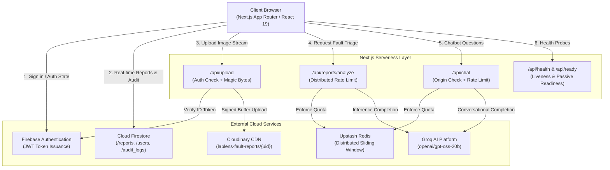

# LabLens AI

**Smart Laboratory Fault Reporting & Equipment Intelligence Platform**

LabLens AI is an academic laboratory management and equipment fault reporting platform. It centralizes incident intake, accelerates maintenance triage with Groq-powered AI diagnostics, tracks technician assignments in real time, and maintains an immutable institutional audit trail.

---

## 1. Problem Statement

Academic and engineering laboratory facilities often struggle with decentralized, unstructured fault reporting:
- **Delayed Maintenance Triage:** Broken oscilloscopes, faulty power supplies, misconfigured network switches, and damaged workstations are frequently reported through informal chat groups, verbal remarks, or paper logs.
- **Safety Hazards:** Faulty electrical hardware or damaged power supplies remain energized and unmarked, posing safety hazards to students and researchers.
- **Lack of Institutional Accountability:** Lab administrators cannot accurately track technician resolution times, equipment failure frequencies, or historical repair costs across campus buildings.
- **Triage Inefficiency:** Administrative staff spend valuable time manually categorizing symptoms, assessing urgency, and routing tickets to technical staff.

---

## 2. Our Solution

LabLens AI transforms laboratory maintenance into a structured, intelligent operational workflow:
- **Rapid Reporting:** Students and lab assistants submit equipment tickets in seconds with structured fault descriptions and optional diagnostic photos.
- **Groq AI Triage:** High-throughput Groq AI analyzes equipment symptoms server-side, recommends operational categories, estimates urgency tiers, and suggests immediate non-hazardous safety precautions.
- **Centralized Operations Hub:** Departmental administrators view live tickets, monitor global institutional metrics, assign dedicated technicians, and override triage priority.
- **Immutable Audit Logging:** Every administrative action (status transition, priority override, technician dispatch, ticket deletion) is committed atomically to an append-only audit trail.
- **Zero-Barrier Demonstrability:** Visitors can immediately test both student reporting and administrative command workflows through isolated in-memory public demo modes without registration.

---

## 3. Key Features

### 🔬 Fault Reporting & Media Attachment
- **Guided Intake:** Pre-configured laboratory selections, asset identifiers, equipment types, and symptom descriptions.
- **Secure Image Uploads:** Signed, server-mediated uploads to Cloudinary with strict magic-byte (file signature) validation for JPEG, PNG, WebP, and GIF.
- **Upload Resilience:** Prevents ticket submission while uploads are in flight or if an upload has failed.

### ⚡ Groq AI Fault Analysis & Safety Triage
- **Groq Exclusivity:** Groq AI powers all platform intelligence (`openai/gpt-oss-20b` default, `qwen/qwen3.8-27b` supported).
- **Automated Recommendations:** Evaluates fault urgency (Critical, High, Medium, Low) and assigns operational categories (Hardware, Software, Power/Electrical, Network, Optical, Calibration).
- **Immediate Advisory Steps:** Generates safe, non-hazardous initial checks (e.g., inspecting external power cords) while strictly advising against opening device casings or live electrical probing.
- **Graceful Degradation:** Provides deterministic, offline-safe fallback analysis if external AI services are unconfigured or unavailable.

### 📊 Operations Command Center & Metrics
- **Real-Time Windowed Feed:** 25-record sliding window ordered newest-first to prevent unbounded collection downloads.
- **Cursor-Based Pagination:** Retrieve historical records on demand using Firestore `startAfter` cursors.
- **Accurate Institutional Counts:** Global summary counters (Total Tickets, Pending Review, Assigned, In Progress, Resolved, Critical) calculated using native server-side aggregation queries (`getCountFromServer`), never extrapolated from the current page.
- **Administrative Triage Modal:** Update operational status, reassign technicians with automatic timestamps, and record administrative notes.

### 🛡️ Immutable Administrative Audit Trail
- **Append-Only Architecture:** Recorded in a dedicated `/audit_logs` collection.
- **Atomic Commit Guarantee:** Report updates or deletions commit in the exact same Firestore `writeBatch` as their corresponding audit record.
- **Tamper-Proof Rules:** Enforced by Firestore Security Rules (`allow update, delete: if false;`). Administrators cannot forge actions under another administrator's identity.

### 💬 Omnipresent Floating AI Assistant
- **Accessible Everywhere:** Fixed bottom-right launcher available across all public, demo, and authenticated application pages.
- **Concise Response Style:** Direct answers in the opening sentence, followed by 2–5 practical bullet points. Avoids lengthy manuals or unnecessary tables.
- **Strict Electrical Safety Guardrails:** Immediately warns against opening device casings, touching internal capacitors, or probing live circuits with multimeters.
- **Apple-Inspired Loading State:** Minimalist 3-dot animated bouncing indicator with subtle `"Thinking..."` label. Zero technical provider or endpoint leakage.

### 🎭 Public Demonstration Mode
- **Zero-Registration Exploration:** Visitors can test the platform immediately from the landing page via **User Demo** (`/demo`) and **Admin Demo** (`/demo/admin`).
- **In-Memory Isolation:** Demo ticket creation, simulated photo attachments, and triage actions update local state only—strictly issuing zero Firestore writes.

---

## 4. Screenshots

> *The interface screenshots below represent planned UI captures from the platform. Static asset placeholders are designated in `public/screenshots/`.*

| Screen | Description | Asset Location (Placeholder) |
| :--- | :--- | :--- |
| **Landing Page** | Institutional welcome with direct access to Public User Demo, Admin Demo, and Authentication. | `public/screenshots/landing-page.png` *(Placeholder)* |
| **Fault Report Form** | Guided ticket creation with live Groq AI symptom analysis and secure photo attachment. | `public/screenshots/report-form.png` *(Placeholder)* |
| **Student Dashboard** | Equipment ticket directory with real-time status badges, filter controls, and AI advisory notes. | `public/screenshots/user-dashboard.png` *(Placeholder)* |
| **Operations Hub** | Centralized administrative triage command center with institutional metrics and ticket directory. | `public/screenshots/admin-hub.png` *(Placeholder)* |
| **Audit Trail** | Append-only institutional audit log viewer with action filters, omni-search, and change diffs. | `public/screenshots/audit-trail.png` *(Placeholder)* |
| **Floating Assistant** | Omnipresent AI assistant providing concise equipment advice and safety protocols. | `public/screenshots/floating-chatbot.png` *(Placeholder)* |

---

## 5. Technology Stack

| Layer | Technology | Version | Purpose |
| :--- | :--- | :--- | :--- |
| **Frontend Framework** | Next.js (App Router) | `16.4.6` | Server-rendered pages, Route Handlers, and Turbopack compiler |
| **Language & Typing** | TypeScript | `^5.0` | End-to-end type safety across client and server |
| **Styling & Design** | Tailwind CSS | `4.3.3` | Apple-inspired design system with `@tailwindcss/turbopack` |
| **Icons & Visuals** | Lucide React | `^1.73.0` | Minimalist interface iconography |
| **Authentication** | Firebase Authentication | `11.10.0` | Client authentication with verified server-side JWT validation (`jose`) |
| **Database** | Cloud Firestore | `11.10.0` | Real-time NoSQL data store with windowed subscriptions & aggregation queries |
| **AI Inference** | Groq SDK | `^1.6.0` | Fast server-side LLM inference (`openai/gpt-oss-20b`) |
| **Media Storage** | Cloudinary SDK | `^2.11.0` | Server-signed media delivery and UID-scoped image asset storage |
| **Distributed Rate Limiting** | Upstash Redis | `@upstash/redis` `^1.41.0` | Distributed sliding-window rate limiter with fail-closed production semantics |
| **Deployment Target** | Vercel | Production | Serverless hosting target |

---

## 6. System Architecture



---

## 7. How It Works

### A. Student & Faculty Fault Reporting Flow
1. **Intake & Description:** The user navigates to `/report`, selects the academic laboratory (e.g., Computer Systems Lab, Physics Lab) and equipment name, enters the asset tag, and describes the malfunction symptoms.
2. **AI Advisory Diagnostics:** Clicking **Analyze Symptoms** dispatches a rate-limited request to `/api/reports/analyze`. Groq AI evaluates the text and returns an operational category recommendation, urgency rating, and immediate non-hazardous safety precautions.
3. **Optional Photo Upload:** When attaching a photo, the browser submits the file to `/api/upload`. The server verifies the Firebase ID token, validates the image's raw binary signatures (magic bytes) to reject forged files, and streams the buffer to Cloudinary under `lablens-fault-reports/{uid}/`.
4. **Firestore Commit:** The report document is written to Cloud Firestore with status `Reported`, including the reporter's metadata, AI analysis payload, and optional Cloudinary secure URL.
5. **Dashboard Tracking:** The user tracks their active ticket on `/dashboard`, observing live status updates as technicians are dispatched.

### B. Administrator Triage & Resolution Flow
1. **Operations Overview:** Verified administrators log in and are routed to `/admin`. The Operations Hub loads global institutional metrics via `getCountFromServer()` and establishes a windowed real-time listener for the 25 newest tickets.
2. **Ticket Triage:** The administrator opens the **Triage Modal** on any reported ticket to:
   - Transition status (`Reported` → `In-Review` → `Assigned` → `In-Progress` → `Resolved` or `Cancelled`).
   - Assign or reassign authorized laboratory technicians (automatically timestamped).
   - Override operational category or priority if physical inspection differs from initial user reports.
   - Record internal maintenance notes.
3. **Atomic Audit Logging:** The triage mutation and corresponding audit record are committed in a single Firestore `writeBatch`.
4. **Historical Audit Inspection:** Administrators switch to the **Audit Trail** tab to inspect chronological changes, search by asset ID or administrator name, and review before/after change diffs.

---

## 8. Installation & Setup

### Prerequisites
- **Node.js:** `v20.x` or `v22.x` (verified on Node `v22.23.3`)
- **npm:** `v10.x`
- **Java Runtime (for Local Emulators):** Java 11 or higher (verified on OpenJDK 21)
- **Git**

### Step-by-Step Local Setup

1. **Clone the Repository:**
   ```bash
   git clone https://github.com/prosofproest/IPDC.git
   cd IPDC
   ```

2. **Install Dependencies:**
   ```bash
   npm install
   ```

3. **Configure Environment Variables:**
   ```bash
   cp .env.example .env.local
   ```
   Open `.env.local` and populate your service credentials (see Section 9 below).

4. **Start the Development Server:**
   ```bash
   npm run dev
   ```
   Open [http://localhost:3000](http://localhost:3000) in your browser.

5. **Run with Local Firebase Emulators (Optional):**
   ```bash
   # Launch Firebase Auth & Firestore emulators
   npm run test:emulator
   ```

---

## 9. Environment Variables

The project includes a canonical template at `.env.example`. Variables prefixed with `NEXT_PUBLIC_` are accessible in the client bundle; all other variables are strictly server-only secrets.

| Variable Name | Exposure | Required | Description |
| :--- | :--- | :--- | :--- |
| `NEXT_PUBLIC_FIREBASE_API_KEY` | Public / Client | Yes | Firebase Web API key |
| `NEXT_PUBLIC_FIREBASE_AUTH_DOMAIN` | Public / Client | Yes | Firebase Authentication domain |
| `NEXT_PUBLIC_FIREBASE_PROJECT_ID` | Public / Client | Yes | Firebase project identifier |
| `NEXT_PUBLIC_FIREBASE_STORAGE_BUCKET`| Public / Client | Yes | Firebase Cloud Storage bucket name |
| `NEXT_PUBLIC_FIREBASE_MESSAGING_SENDER_ID` | Public / Client | Yes | Firebase cloud messaging sender ID |
| `NEXT_PUBLIC_FIREBASE_APP_ID` | Public / Client | Yes | Firebase web application identifier |
| `CLOUDINARY_CLOUD_NAME` | Server Only | Yes | Cloudinary cloud namespace |
| `CLOUDINARY_API_KEY` | Server Only | Yes | Cloudinary server API key |
| `CLOUDINARY_API_SECRET` | Server Only | Yes | Cloudinary server API secret |
| `GROQ_API_KEY` | Server Only | Yes | Groq AI API key for LLM triage and chat |
| `GROQ_MODEL` | Server Only | Optional | Groq model ID (default: `openai/gpt-oss-20b`) |
| `APP_TRUSTED_ORIGINS` | Server Only | Prod Only | Comma-separated allowlist of origins for guest chat |
| `NEXT_PUBLIC_APP_URL` | Public / Client | Prod Only | Canonical production URL (e.g., `https://lablens.ac.in`) |
| `UPSTASH_REDIS_REST_URL` | Server Only | Prod Only | Upstash Redis REST endpoint for distributed rate limiting |
| `UPSTASH_REDIS_REST_TOKEN` | Server Only | Prod Only | Upstash Redis REST authentication token |

---

## 10. Security & Hardening

LabLens AI is built with multi-layered application security:

1. **Content Security Policy (CSP) & Headers:**
   - Strict CSP configured in `next.config.ts` allowing connections only to Firebase Auth/Firestore, Cloudinary, and application origins.
   - Standard security headers: `X-Frame-Options: DENY`, `X-Content-Type-Options: nosniff`, `Referrer-Policy: strict-origin-when-cross-origin`, and `Permissions-Policy`.

2. **File Signature (Magic-Byte) Validation:**
   - Uploaded images are validated at the byte buffer level before invoking Cloudinary.
   - Detects real binary magic bytes for JPEG (`FF D8 FF`), PNG (`89 50 4E 47`), GIF (`47 49 46 38`), and WebP (`RIFF...WEBP`).
   - Rejects forged file extensions, truncated headers, missing trailers, and non-image payloads disguised as images.

3. **Role-Based Access Control & Document Immutability:**
   - Enforced natively via [`firestore.rules`](file:///Users/hruthwicktn/Projects/IPDC/firestore.rules).
   - Standard users can only create tickets with initial status `Reported` and cannot alter administrative fields.
   - Administrators cannot modify immutable reporter identity or equipment details.
   - Audit logs are append-only (`allow update, delete: if false;`).

4. **Production Distributed Rate Limiting (Fail-Closed):**
   - Protected endpoints (`/api/chat` and `/api/reports/analyze`) use Upstash Redis with a sliding window algorithm.
   - In production (`NODE_ENV === "production"`), if Redis is unconfigured or unreachable, the system **fails closed** (`503 Service Unavailable`), preventing quota bypass across serverless instances.

5. **Structured Logging & Credential Redaction:**
   - Server logger automatically sanitizes Authorization headers, Bearer tokens, RS256 JWT strings, passwords, and API keys before outputting structured JSON logs.

---

## 11. Testing & Quality Assurance

Every layer of the platform is validated through automated test suites:

| Test Command | Scope & Focus | Suite Size | Result |
| :--- | :--- | :--- | :--- |
| `npm test` | Core upload failure (10), upload auth (5), signed Cloudinary (17), Groq triage (10), admin triage (25), Phase 1 security (43), demo mode (40), magic-bytes upload (35) | 185 tests | **185/185 PASSED** |
| `npx tsx scripts/test-phase3-scalability.mjs` | Logger redaction, health probes, fail-closed rate limiter, audit schema | 28 tests | **28/28 PASSED** |
| `npx tsx scripts/test-chatbot-ux.mjs` | Chatbot conversational style, loading states, electrical safety, failure modes | 29 tests | **29/29 PASSED** |
| `npm run test:chatbot` | Chatbot omnipresence, viewports, dialog bounds, and key interactions via CDP | 79 tests | **79/79 PASSED** |
| `npm run test:emulator` | Firestore security rules emulator (41 tests) + E2E status lifecycle workflow (16 tests) | 57 tests | **57/57 PASSED** |
| `npm run test:browser` | Comprehensive headless Chrome browser verification across 7 viewports | 60 tests | **60/60 PASSED** |
| `npm run lint` | ESLint rules and React 19 / Next.js hook compliance | Codebase | **0 Errors, 0 Warnings** |
| `npm run build` | Turbopack production compilation (18 routes) | Build check | **Compiled Successfully** |

---

## 12. Deployment

LabLens AI is optimized for deployment on **Vercel**:

1. **Connect Repository:** Import the repository into your Vercel Dashboard.
2. **Framework Preset:** Select **Next.js**.
3. **Build Command:** `next build` (using Turbopack).
4. **Environment Variables:**
   - Configure all variables from `.env.example`.
   - Ensure `UPSTASH_REDIS_REST_URL` and `UPSTASH_REDIS_REST_TOKEN` are set so rate limiting operates in production mode.
   - Set `APP_TRUSTED_ORIGINS` to your production domains (e.g., `https://your-domain.vercel.app`).
5. **Deploy:** Deploy the project and verify `/api/health` returns `{"status":"ok"}`.

> **Operational Note:** Live Cloudinary uploads and Groq AI inference require valid credentials configured in the production environment. When credentials are not provided, the platform automatically enters a safe fallback state without throwing unhandled exceptions.

---

## 13. Project Impact & Future Scope

### Practical Institutional Impact
- **Reduced Equipment Downtime:** Speeds up fault triage and technician dispatches across multi-department campuses.
- **Laboratory Safety:** Immediately warns students and staff away from damaged electrical equipment, reducing workplace and lab hazards.
- **Institutional Memory:** Provides department heads with transparent data on equipment reliability, recurring failure patterns, and repair turnaround metrics.

### Future Scope (Planned Enhancements)
- **Equipment QR Code Scanning:** Scan asset tags using a smartphone camera to immediately pull up ticket history and pre-fill fault reports.
- **Automated IoT Sensor Telemetry:** Direct webhook ingestion for smart lab bench power supplies and temperature monitors.
- **SMS & Push Notifications:** Automated alert dispatches to on-duty laboratory technicians when Critical tickets are lodged.

---

## 14. Contributing & License

### Contributing
Contributions to LabLens AI are welcome:
1. Fork the repository.
2. Create a feature branch (`git checkout -b feature/improvement-name`).
3. Commit your changes with descriptive commit messages.
4. Ensure all test suites pass (`npm test`, `npm run lint`, `npm run build`).
5. Push to your branch and open a Pull Request.

### License
This project is an academic and institutional software application developed for laboratory equipment management. All rights reserved by the original project authors. Consult the repository maintainers for institutional licensing and deployment permissions.
